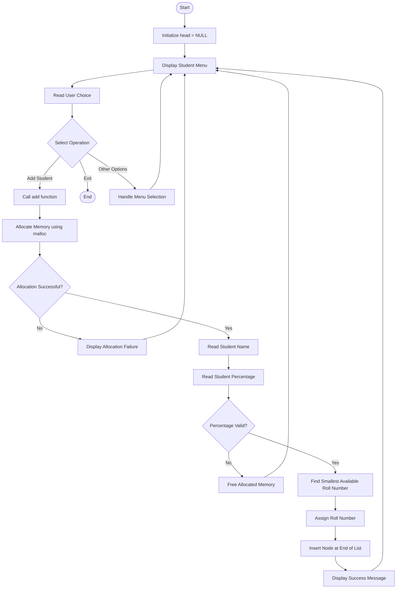

# Student Record Management System

A menu-driven **Student Record Management System developed using C**. This project focuses on practical implementation of C programming concepts such as structures, pointers, dynamic memory allocation, and singly linked lists.

## Project Overview

The application manages student records using a dynamically allocated singly linked list. Each student record contains a name, roll number, and percentage.

The system automatically assigns the smallest available positive roll number whenever a new student record is added.

## Current Features

- Menu-driven user interface.
- Add new student records.
- Dynamic memory allocation using `malloc()`.
- Student information management using structures.
- Automatic assignment of the smallest available roll number.
- Percentage validation (0–100).
- Insertion of new nodes at the end of a singly linked list.
- Basic memory allocation failure handling.
- Modular programming using separate source and header files.

## Project Structure

```text
Student-Record-Management-System/
│
├── main.c        # Main function and menu handling
├── add.c         # Student addition and linked-list insertion
├── student.h     # Structure definition and function declarations
└── README.md     # Project documentation
```

## Project Flowchart



## Student Addition Workflow

1. Allocate memory for a new student node using `malloc()`.
2. Read the student's name.
3. Read and validate the percentage.
4. Traverse the existing linked list to find the smallest available positive roll number.
5. Assign the roll number to the new node.
6. Insert the new node at the end of the linked list.
7. Return a status indicating whether the operation succeeded.

## Concepts Used

- C Programming Fundamentals
- Structures and Self-Referential Structures
- Pointers and Double Pointers
- Dynamic Memory Allocation (`malloc()` and `free()`)
- Singly Linked Lists
- Pointer Traversal
- String Handling
- Input Validation
- Modular Programming
- Header Files and Include Guards
- Function Return Values

## Compilation and Execution

### Linux / WSL

Compile the project:

```bash
gcc -Wall -Wextra -Wpedantic main.c add.c -o student_manager
```

Run:

```bash
./student_manager
```

### Windows (PowerShell)

Compile:

```powershell
gcc -Wall -Wextra -Wpedantic main.c add.c -o student_manager.exe
```

Run:

```powershell
.\student_manager.exe
```

## Planned Features

- Display all student records.
- Delete a specific student record.
- Modify existing student information.
- Sort student records.
- Reverse the linked list.
- Delete all student records.
- Save student records using file handling.
- Load previously saved records when the application starts.
- Improve input validation and error handling.

## Project Goal

The objective of this project is to strengthen practical C programming skills by developing a student record management application incrementally and understanding the underlying logic of pointers, structures, dynamic memory allocation, and linked lists.
