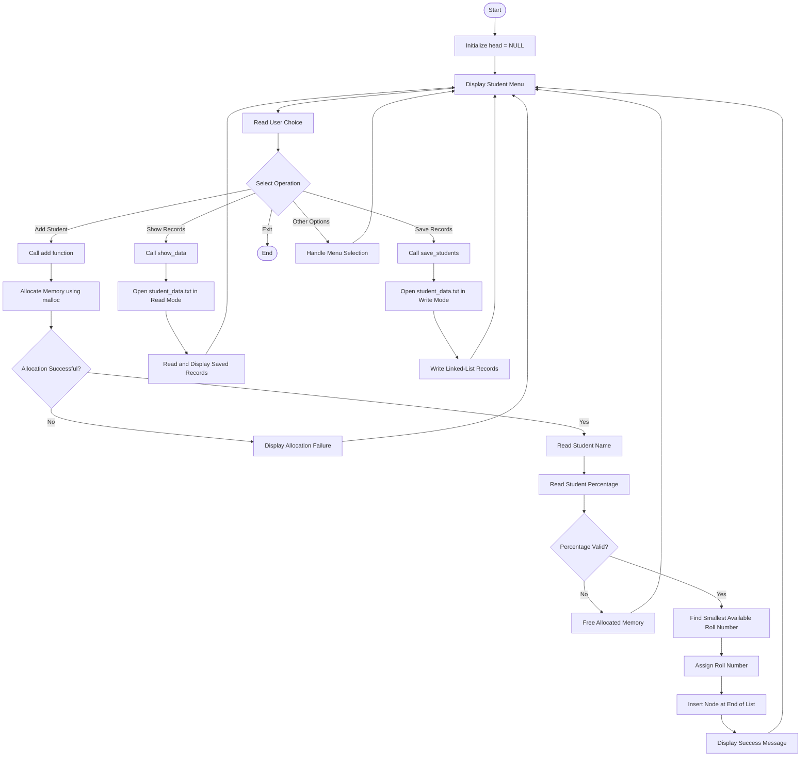

# Student Record Management System

A menu-driven **Student Record Management System developed using C**. This project focuses on practical implementation of C programming concepts such as structures, pointers, dynamic memory allocation, singly linked lists, and file handling.

## Project Overview

The application manages student records using a dynamically allocated singly linked list. Each student record contains a name, roll number, and percentage.

The system automatically assigns the smallest available positive roll number whenever a new student record is added.

The application also supports saving student records to a text file and displaying previously saved records using file handling operations.

## Current Features

- Menu-driven user interface.
- Add new student records.
- Dynamic memory allocation using `malloc()`.
- Student information management using structures.
- Automatic assignment of the smallest available roll number.
- Percentage validation (0–100).
- Insertion of new nodes at the end of a singly linked list.
- Display saved student records from a text file.
- Save linked-list records to a text file using `fprintf()`.
- Read student records using `fgets()` and `sscanf()`.
- Basic file-opening and memory-allocation failure handling.
- Modular programming using separate source and header files.

**Note:** Previously saved records can be displayed, but automatic loading of saved records into the linked list when the application starts is not implemented yet.

## Project Structure

```text
Student-Record-Management-System/
│
├── main.c          # Main function and menu handling
├── add.c           # Student addition and linked-list insertion
├── save.c          # Saving student records to a file
├── show.c          # Reading and displaying saved records
├── student.h       # Structure definition and function declarations
├── README.md       # Project documentation
└── student_data.txt # Runtime data file (created when saving records)
```

## Project Flowchart



## Student Addition Workflow

1. Allocate memory for a new student node using `malloc()`.
2. Read the student's name.
3. Read and validate the percentage.
4. Traverse the existing linked list to find the smallest available positive roll number.
5. Assign the roll number to the new node.
6. Insert the node at the end of the linked list.
7. Return a status indicating whether the operation succeeded.

## File Handling Workflow

### Saving Student Records

1. Open `student_data.txt` in write mode using `fopen()`.
2. Check whether the file was opened successfully.
3. Traverse the linked list.
4. Write each student's details using `fprintf()`.
5. Close the file using `fclose()`.

### Displaying Student Records

1. Open `student_data.txt` in read mode.
2. Read each line using `fgets()`.
3. Extract student details using `sscanf()`.
4. Display the records in a formatted table.
5. Close the file using `fclose()`.

## Concepts Used

- C Programming Fundamentals
- Structures and Self-Referential Structures
- Pointers and Double Pointers
- Dynamic Memory Allocation (`malloc()` and `free()`)
- Singly Linked Lists
- Pointer Traversal
- String Handling
- Input Validation
- File Handling (`fopen()`, `fprintf()`, `fgets()`, `sscanf()`, `fclose()`)
- Modular Programming
- Header Files and Include Guards
- Function Return Values
- Error Handling

## Compilation and Execution

### Linux / WSL

Compile:

```bash
gcc -Wall -Wextra -Wpedantic main.c add.c save.c show.c -o student_manager
```

Run:

```bash
./student_manager
```

### Windows (PowerShell)

Compile:

```powershell
gcc -Wall -Wextra -Wpedantic main.c add.c save.c show.c -o student_manager.exe
```

Run:

```powershell
.\student_manager.exe
```

## Planned Features

- Delete a specific student record.
- Modify existing student information.
- Sort student records.
- Reverse the linked list.
- Delete all student records.
- Load previously saved records into the linked list when the application starts.
- Improve input validation and error handling.
- Improve file handling and data persistence.

## Project Goal

The objective of this project is to strengthen practical C programming skills by developing a student record management application incrementally and understanding the underlying logic of pointers, structures, dynamic memory allocation, linked lists, and file handling.
